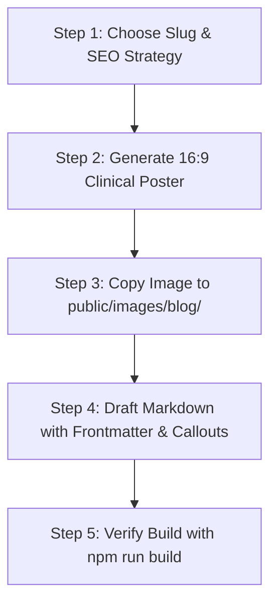

# Nerivahealth Blog Creation Skill

This skill defines the complete Standard Operating Procedure (SOP) for researching, writing, illustrating, and publishing medical and physiotherapy blog posts for the **Nerivahealth Physiotherapy & Rehabilitation Centre** website.

Whenever any AI model or agent is asked to create or generate a blog post for Neriva, it **must** strictly follow this workflow to guarantee consistent medical authority, visual excellence, SEO performance, and aesthetic standards.

---

## 1. Core Identity & Editorial Standards

- **Medical Authority:** All articles are presented as written and clinically reviewed by **Dr. Abhishek Kumar (PT)**, BPT, MPT (Orthopedics), Clinic Director at Nerivahealth Physiotherapy & Rehabilitation Centre, Sector 45, Faridabad (HSCP Reg. HSCP/PT/2022/1583).
- **Tone:** Empathetic, scientifically accurate, actionable, and reassuring. Avoid overly dense academic jargon; explain physiological concepts with clear real-world analogies.
- **Word Count:** 800 – 1,400 words.
- **Target Audience:** Patients experiencing pain, stiffness, sports injuries, or recovery challenges in Faridabad, Delhi NCR, and online readers looking for professional physiotherapy advice.
- **Local SEO Integration:** Naturally mention Nerivahealth's location (Sector 45, Faridabad) and relevant treatments in the final clinic consultation section.

---

## 2. Step-by-Step Publishing Workflow

Follow these 5 steps in exact sequential order:



### Step 1: Choose Slug & SEO Strategy
1. **Slug:** Choose a descriptive, hyphenated kebab-case slug (e.g. `sciatica-relief-dos-and-donts`, `plantar-fasciitis-morning-heel-pain`).
2. **Category:** Select one of the established categories:
   - `Orthopedics & Spine`
   - `Sports Rehabilitation`
   - `Post-Op Rehabilitation`
   - `Ergonomics & Posture`
   - `Joint Health & Mobility`
   - `Patient Education`
3. **Emoji Icon:** Pick a relevant emoji (e.g. 🦴, 🏃, 💻, ⚡, 🩺, 🧘).

---

### Step 2: Generate 16:9 Featured Poster
Every blog post **MUST** have its own custom, high-resolution 16:9 featured clinical image. Never leave the banner blank or use generic stock photos.

Use the `generate_image` tool with:
- `AspectRatio`: `'16:9'`
- `ImageName`: `<slug>_poster`
- `Prompt Formula`:
  ```text
  Professional modern medical 3D visual and clinical photography blend illustrating [SPECIFIC CONDITION / BODY PART, e.g., lumbar spine sciatica nerve relief or rotator cuff rehabilitation]. Clean modern physiotherapy clinic background, soft cinematic lighting, deep navy blue (#0F172A) and teal (#0D9488) accents, transparent glowing anatomical highlight of the [TARGET JOINT/MUSCLE], realistic, hyper-detailed, clean medical aesthetic, no text.
  ```

---

### Step 3: Copy Image to `public/images/blog/`
Antigravity saves generated images into the conversation artifacts directory. You must copy the resulting file into the repository's public image assets:

```powershell
# In PowerShell:
Copy-Item "<ARTIFACT_IMAGE_PATH>" "public\images\blog\<slug>.jpg" -Force
```

Confirm that `public/images/blog/<slug>.jpg` exists.

---

### Step 4: Write Blog Markdown File
Create `src/pages/blog/<slug>.md`.

#### Mandatory Frontmatter Schema
```yaml
---
layout: ../../layouts/BlogPost.astro
title: "Clear, Engaging Patient-First Headline"
description: "Compelling 140-160 character meta description explaining the cause, remedy, and benefits."
date: "MMM DD, YYYY"
category: "Category Name"
readTime: "5 min read"
image: "/images/blog/<slug>.jpg"
icon: "🩺"
---
```

#### Mandatory Content Structure
1. **Key Takeaways Box (Immediately after frontmatter):**
   ```html
   <div class="key-takeaways-box">
       <h4>📌 Key Takeaways</h4>
       <ul>
           <li>Summary point 1: Immediate clinical reality or stat.</li>
           <li>Summary point 2: Core exercise or behavioral fix.</li>
           <li>Summary point 3: When professional clinical assessment is required.</li>
       </ul>
   </div>
   ```

2. **Introduction (2-3 paragraphs):**
   - Empathize with the patient's daily frustration (e.g. pain when standing up, morning stiffness).
   - Explain the underlying anatomy or biomechanics simply.

3. **Core Sections (H2 & H3 headings):**
   - 3 to 5 structured, numbered sections detailing specific exercises, dos & don'ts, or stages of recovery.
   - Use bullet points with **bold prefixes** for readability:
     - `- **How to do it:** ...`
     - `- **Repetitions / Hold:** ...`
     - `- **Why it works:** ...`

4. **Doctor Tip Box (Middle or After Exercises):**
   ```html
   <div class="doctor-tip-box">
       <div class="doctor-tip-badge">👨‍⚕️ Clinical Tip from Dr. Abhishek Kumar (PT)</div>
       <p>"Actionable golden rule or common mistake to avoid during rehabilitation."</p>
   </div>
   ```

5. **Exercise Cards (Optional, for workout/stretch guides):**
   ```html
   <div class="exercise-card">
       <span class="exercise-tag">Phase 1: Mobility</span>
       <h4>Exercise Name</h4>
       <p>Execution details, target muscle groups, and progression cues.</p>
   </div>
   ```

6. **Red Flags & Warning Signs ("When to See a Specialist"):**
   - Clearly delineate when self-treatment must stop (numbness, radiating sharp shooting pain, loss of motor control, fever, etc.).

7. **Nerivahealth Clinic Recommendation (Closing Section):**
   - Concrete call-to-action mentioning Dr. Abhishek Kumar and the clinic in Sector 45, Faridabad.
   - *Note:* The layout already appends contact buttons ("Book Clinic Assessment", WhatsApp link) and the author bio box automatically at the bottom.

---

### Step 5: Verify Build & Static Generation
Always verify that Astro compiles the new markdown route cleanly:

```powershell
npm run build
```

Verify that:
1. `dist/blog/<slug>/index.html` is generated.
2. `dist/blog/index.html` builds without errors.
3. No broken image links or markdown syntax errors exist.

---

## 3. Reference Files
- Full ready-to-copy Markdown template: [template.md](./references/template.md)
- Curated AI image prompts by medical condition: [image-prompts.md](./references/image-prompts.md)
